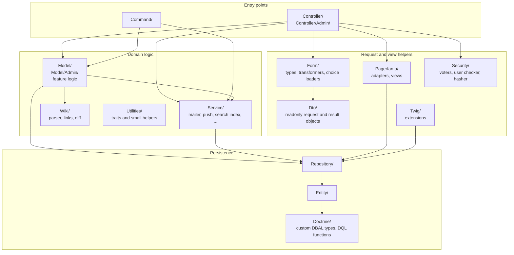
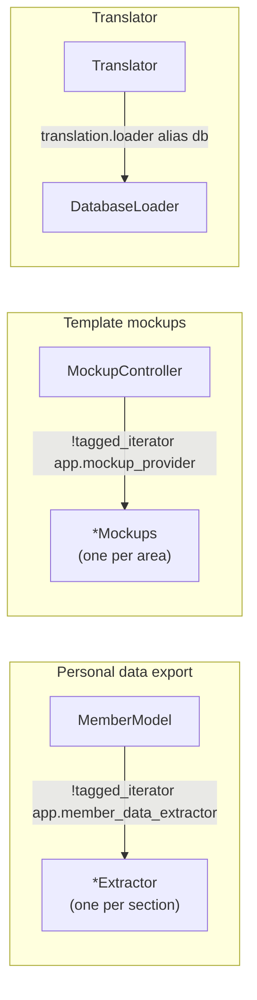

# Code structure

All PHP code lives in `src/` under the `App\` namespace and is registered as services by autowiring
and autoconfiguration ([`config/services.yaml`](../../config/services.yaml)). Entities and Twig
extensions are excluded from the automatic registration; the Twig extensions are listed explicitly.

## Layers

The rule of thumb: controllers stay thin. They bind the request (forms, `#[MapRequestPayload]`,
route parameters resolved to entities), check access with `#[IsGranted]`, call a model or service,
and render a template. The logic of a feature lives in its model, for example `ForumModel`,
`ConversationModel`, `GroupModel`, `TripModel`.

## Directories

| Directory | Role |
| --- | --- |
| `Controller/` | One controller per feature area (forums, groups, conversations, profile, trips, ...). Routes are PHP attributes; `config/routes.yaml` loads them all. |
| `Controller/Admin/` | Volunteer tools under `/admin` (rights, flags, comments, mass mail, newsletter, translations, treasurer, checker, logs, mockups). |
| `Model/` | Feature logic used by controllers and commands. `Model/Admin/` for the volunteer tools, `Model/MemberDataExtractor/` for the personal data export, `Model/MockupProvider/` for the template mockups, `Model/Translation/` for the translation tool. |
| `Service/` | Cross-cutting services: `Mailer`, browser push (`BrowserNotificationService`, `PushGateway`, ...), `ForumSearch` / `ForumSearchIndex`, `MailLinkSigner`, `InPlaceTranslations`, `InboxFolders`, `MessageSender`. |
| `Entity/` | Doctrine entities, mapped with attributes. See [Data model](03-data-model.md). |
| `Repository/` | Query code for the entities (DQL, query builders, some native SQL). |
| `Doctrine/` | Custom DBAL types for MariaDB `ENUM` and `SET` columns (`EnumType`, `SetType` and one subclass per column) and DQL functions (`GeoDistance`, `DateDiff`, `YearWeek`). |
| `Form/` | Symfony form types. `Form/CustomDataClass/` holds the data objects some forms are bound to, `Form/DataTransformer/` converts between form and model values. |
| `Dto/` | Readonly data transfer objects (search results, trip and activity input, reply rates, ...). |
| `Security/` | Voters per subject (`ForumVoter`, `GroupVoter`, `ConversationVoter`, `MemberVoter`, `TripVoter`, `ActivityVoter`, `PollVoter`), `UserChecker`, the legacy password hasher, account exceptions. |
| `EventListener/`, `EventSubscriber/` | Kernel and security event hooks. See [Request lifecycle](02-request-lifecycle.md). |
| `TranslationLoader/` | `DatabaseLoader`, the translator's loader for the `word` table. |
| `Twig/` | Twig functions and filters (`Extension`, `MemberTwigExtension`, `FlagsExtension`, `AnalyticsExtension`, `MockupExtension`). |
| `Wiki/` | Wiki markup parser, link resolver, diff and page names for the site and group wikis. |
| `Pagerfanta/` | Pager adapters for conversations, search results, word lists and the pager templates. |
| `Command/` | Console commands. See [Background jobs](05-background-jobs.md). |
| `Processor/Fixtures/` | Alice fixture processors used to seed development and test databases. |
| `Utilities/` | Traits shared by controllers and models (translated flashes, redirect back, submenus) and small helpers. |

Outside `src/`:

| Path | Role |
| --- | --- |
| `templates/` | Twig templates, one folder per feature, plus `emails/`, `macros/`, `_partials/`, `base.html.twig` |
| `assets/` | JavaScript, TypeScript, SCSS and Tailwind sources. See [Front end](08-frontend.md). |
| `translations/` | File-based placeholders; the texts themselves come from the database |
| `Migrations/` | Doctrine migrations (namespace `DoctrineMigrations`) |
| `config/` | Bundle configuration (`packages/`), services, routes |
| `fixtures/` | Alice fixtures for local and test databases |
| `tests/` | PHPUnit tests, mirroring `src/` |
| `public/` | Web root: `index.php`, compiled assets in `build/`, the service worker, manifest |
| `data/`, `upload/` | Files written by the application (gallery, group pictures, uploads, exports) |

## Extension points

A few places collect services by tag, so a new implementation only needs the tag:

- **`app.member_data_extractor`**: each extractor writes one section of the "my data" export
  (messages, forum posts, trips, ...). `DoctrineExtractorFactory` builds generic extractors for simple
  entity-to-member relations.
- **`app.mockup_provider`**: each provider renders example data for templates in `/admin/mockups`, so
  translators and designers can see pages and mails without real data.
