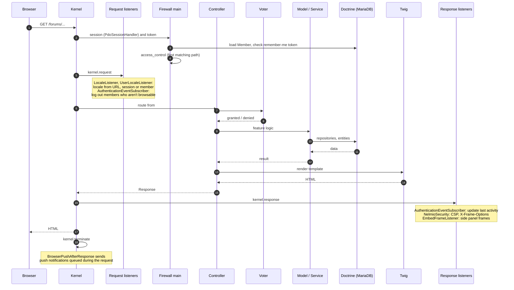

# Request lifecycle

`public/index.php` boots `App\Kernel` through Symfony Runtime. Nginx serves static files from
`public/` itself and passes everything else to PHP-FPM.

## A page request

## Listeners and subscribers

| Class | Event | What it does |
| --- | --- | --- |
| `LocaleListener` | `kernel.request` | Picks the request locale (URL, session) and keeps it in the session |
| `UserLocaleListener` | login, `kernel.request` | Uses the member's preferred language after login |
| `AuthenticationEventSubscriber` | `kernel.request` | Logs out members whose status no longer allows browsing |
| `AuthenticationEventSubscriber` | `kernel.response` | Updates `lastActive` at most every five minutes; a member who comes back after reminders becomes active again |
| `AuthListener` | interactive login | Sets the member's status to active when they log in from a reminded state |
| `AjaxAuthenticationListener` | exception | Returns a status code instead of the login page for AJAX requests of logged-out members |
| `AnalyticsLoginSubscriber` | `LoginSuccessEvent` | Queues a Plausible "Login" event for the next page (not for remember-me logins) |
| `EmbedFrameListener` | `kernel.response` | Pages opened with `?embed=1` may be framed by the site's own side panels; redirects inside a panel become a small "leave the panel" page |
| `BrowserPushAfterResponse` | `kernel.terminate` | Sends the browser push notifications an action created, after the member got the response |

## Sessions and caches

- **Sessions** are stored in the database (`PdoSessionHandler` on Doctrine's connection) and last up to
  seven days after login; "remember me" (one year) uses Doctrine's token provider.
- **Application cache** is the filesystem (`var/cache`). In production Doctrine's query and result
  caches use the `cache.system` and `cache.app` pools; the ORM second level cache is enabled.
- **Locks** use `symfony/lock` with `LOCK_DSN`, for example around rewriting the cached translation
  catalogues.

## Embedded panels and AJAX

Several pages open parts of other pages in a side panel (contact a member, edit a profile section).
These are normal routes rendered with `?embed=1` inside an `iframe` of the site itself. Small AJAX
endpoints (autocomplete, unread counters, search result pages, member previews) return JSON or HTML
fragments from the same controllers.
