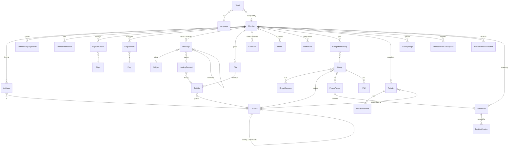
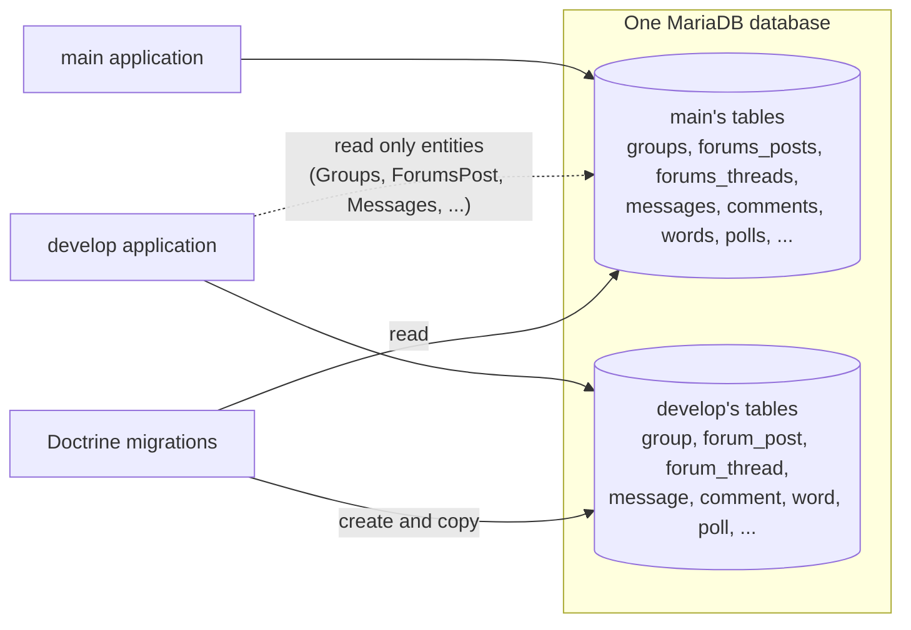

# Data model

The application stores its data in **MariaDB** (`server_version` 12.3) through **Doctrine ORM 3**.
Entities are mapped with PHP attributes in `src/Entity/`. Tables use `utf8mb4`, with
`utf8mb4_unicode_520_ci` as the default collation for new tables.

## Core entities

The diagram shows the main entities and how they hang together. Translation entities
(`*Translation`), preferences and most admin tables are left out.

| Area | Entities (table) |
| --- | --- |
| Members | `Member` (`member`), `Address`, `MemberTranslation`, `MemberLanguageLevel`, `MemberPreference` / `Preference`, `MemberPhoto`, `ProfileVisit`, `ProfileNote` (`mycontacts`), `Friend` |
| Places | `Location` (`location`, from geonames, with a spatial `POINT` column `coordinates`), `LocationTranslation` |
| Conversations | `Message` (`message`), `Subject`, `HostingRequest` (`request`) |
| Trips | `Trip` (`trips`), `Subtrip` (`sub_trips`), `MemberLegHidden`, `MemberLegNotificationSent` |
| Trust | `Comment` (`comment`), `CommentReport` |
| Groups and forums | `Group` (`` `group` ``), `GroupCategory`, `GroupMembership`, `RelatedGroup`, `ForumThread`, `ForumPost`, `MemberThreadSubscription`, `PostNotification` (`posts_notificationqueue`), `Poll` and its choices and votes |
| Community | `Activity`, `ActivityAttendee`, `CommunityNews`, `CommunityNewsComment`, `Newsletter`, `BroadcastMessage`, `Wiki` (`ewiki`), `Faq`, `FaqCategory` |
| Gallery | `Gallery`, `GalleryImage` (`gallery_items`), `GalleryComment`, `UploadedImage` |
| Volunteers | `Right`, `RightVolunteer`, `Flag`, `FlagMember`, `Privilege`, `Role`, `Log`, `LoginMessage`, `Donation` |
| Translations | `Word` (`word`), `Language` |
| Push | `BrowserPushSubscription`, `BrowserPushNotification`, `BrowserPushNotificationDelivery` |
| Sessions | `sessions`, `rememberme_token` (created by Symfony, no entities) |

## Custom column types

Many columns are MariaDB `ENUM` or `SET`. Each such column has its own DBAL type in `src/Doctrine/`
(for example `MemberStatusType`, `ForumVisibilityType`, `CommentQualityType`), built on `EnumType` and
`SetType`, and registered in [`config/packages/doctrine.yaml`](../../config/packages/doctrine.yaml).
The type classes also hold the allowed values as constants, so code compares against
`MemberStatusType::ACTIVE` rather than strings.

Coordinates are `POINT` values (`longitude-one/doctrine-spatial`). DQL gets the spatial functions
`ST_Distance_Sphere`, `MBRContains`, `ST_Contains`, `ST_GeomFromText`, `ST_X`, `ST_Y` and the own
`geodistance`, which is how the member search, trips and activities find places in a map rectangle
or radius using the spatial index on `location.coordinates`.

## Shared with `main`

`main` is the code running in production; this code base (`develop`) will replace it. Until then both
run against the same database (stage and, later, production). That has consequences for the schema:

- Migrations **add** new tables and columns next to `main`'s and copy the data. They don't drop or
  rename anything `main` still uses; the cleanup happens once `main` is gone.
- Entities with plural names (`Groups`, `ForumsPost`, `ForumsThread`, `Messages`, `Comments`, `Words`,
  `Languages`, `Polls`, ...) map `main`'s tables. Most are read only and exist for the copying
  migrations and comparisons.
- `main`'s tables use other collations than the new ones. SQL that mixes text columns of both needs
  `COLLATE`.

## Migrations

Schema changes go through Doctrine Migrations in [`Migrations/`](../../Migrations/) (namespace
`DoctrineMigrations`): change the entity, run `bin/console make:migration`, review the generated SQL,
then `doctrine:migrations:migrate`. Data copies from `main`'s tables are written by hand in the
migration's `up()`. On the servers migrations are run by hand after a deploy.

## Fixtures

Development and test databases are seeded with Alice fixtures from [`fixtures/`](../../fixtures/),
with processors in `src/Processor/Fixtures/` (locations, members, groups, forum threads, gallery
images). `bin/console test:database:create` creates and seeds a local database. Every fixture member
has the password `password`.
