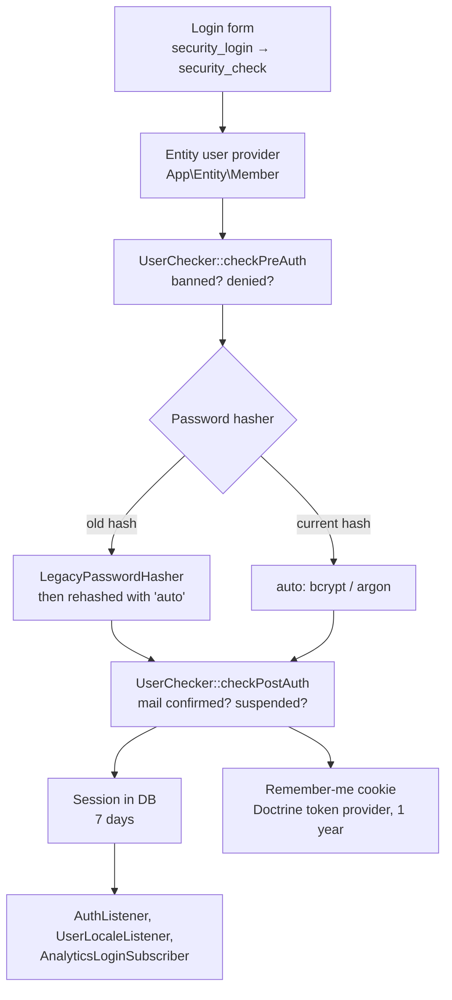
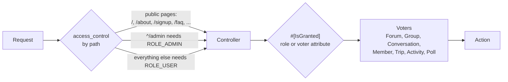

# Security

Configuration: [`config/packages/security.yaml`](../../config/packages/security.yaml),
[`config/packages/nelmio_security.yaml`](../../config/packages/nelmio_security.yaml).

## Authentication

- There is one firewall, `main`, with form login, logout and remember me. Members log in with their
  username or e-mail address (`MemberRepository`).
- Passwords from the old site are verified by `LegacyPasswordHasher` and migrated to the `auto`
  algorithm on the next login (`migrate_from: legacy`). Members with privileges get the stronger
  `harsh` hasher (cost 14, `Member::getPasswordHasherName()`).
- `UserChecker` turns a member's status into login errors (`AccountBannedException`,
  `AccountMailNotConfirmedException`, `AccountSuspendedException`, ...).
- On every request `AuthenticationEventSubscriber` logs out a member whose status no longer allows
  browsing (for example after a ban during an open session).

## Authorisation

Three levels, from coarse to fine:

### Rights become roles

Volunteers get rights (`Right`) through `RightVolunteer` rows, managed in the rights tool
(`/admin/rights`). `Member::getRoles()` turns each right into a role:

| Right in the database | Role |
| --- | --- |
| any member | `ROLE_USER` |
| `Words` | `ROLE_ADMIN_WORDS` |
| `SafetyTeam` | `ROLE_ADMIN_SAFETYTEAM` |
| `ForumModerator` | `ROLE_ADMIN_FORUMMODERATOR` |
| ... one role per right | `ROLE_ADMIN_<RIGHT>` |
| at least one right | additionally `ROLE_ADMIN` (passes the `/admin` access rule) |

The role constants are on `App\Entity\Member` (`Member::ROLE_ADMIN_RIGHTS`, ...). Rights also have a
scope (for example the languages a translator may edit); code that needs it reads the scope from the
`RightVolunteer` row.

### Voters

Access that depends on the subject is decided by voters in `src/Security/`: who may view or reply to a
conversation, see a forum thread (visibility, group membership), administer a group, edit a trip or
activity, vote in a poll. Controllers ask with `#[IsGranted('ATTRIBUTE', subject: 'name')]` or
`isGranted()`; templates with `is_granted()`.

## Protection against forged requests

- **Forms** use Symfony's CSRF tokens.
- **Page actions** (delete, recover, accept, decline, mark as spam, ...) are `POST` requests with a
  CSRF token, checked with `#[IsCsrfTokenValid]`. They are never plain `GET` links.
- **Links in mails** that act for a member without a login (accept an invitation, a join request, a
  friendship, unsubscribe) are `GET` links signed by `MailLinkSigner` with an expiry, checked with
  `#[IsSignatureValid]`. Member pictures in mails are signed the same way, because mail programs load
  them without the member's session.

## Headers and limits

- NelmioSecurityBundle sets the Content Security Policy and `X-Frame-Options: DENY`.
  `EmbedFrameListener` lets the site frame its own side panels.
- NelmioCorsBundle is configured for paths under `/api/` (`CORS_ALLOW_ORIGIN`).
- New members are limited in how many messages and requests they may send per hour and day
  (`new_members_*` parameters).
- The feedback form, which is open to everyone, uses a captcha (GregwarCaptchaBundle).
- User HTML (forum posts, profile texts, wiki) is cleaned with HTMLPurifier (HTML5 definitions) before
  it is shown.
