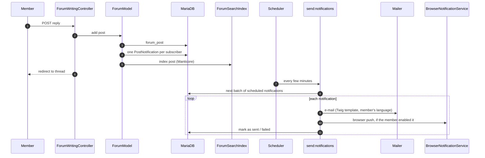
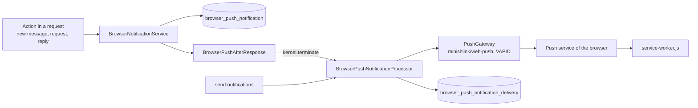

# Background jobs

Rox has no message broker. Work that shouldn't happen during a request is written to a database table
and processed by a console command. The commands are started by the scheduler of the servers
(configured in `sysadmins-infra`); the application itself has no schedule.

## Commands

| Command | Purpose |
| --- | --- |
| `send:notifications` | Sends queued forum notifications (`posts_notificationqueue`) as e-mails and browser push, in batches |
| `send:massmail` | Sends the next batch of a newsletter or mass mail |
| `trips:notifications:send daily\|weekly\|monthly` | Sends trip notification mails to members who chose that frequency in their preferences |
| `comments:send:reminder` | Reminds members to leave a comment after a stay |
| `members:remind:login` | Reminds members who haven't logged in for a long time |
| `members:suspend:notification` | Suspends members away for five years despite reminders; schedules earlier ones for deletion |
| `members:remove:notconfirmed` | Removes sign-ups that never confirmed their e-mail address |
| `data:retention` | Removes the data of retired members (at least daily) |
| `browser-push:retention` | Removes expired push notifications and inactive subscriptions |
| `forum:lock-edit` | Ends editing of posts older than 30 minutes that got a reply |
| `statistics:update` | Stores today's statistics |
| `sitemap:generate` | Writes `public/sitemap.xml` |
| `geonames:update` / `geonames:update:daily` | Full import and daily changes of geonames.org places |
| `manticore:indices:forum` / `manticore:indices:geonames` | Builds the search indices |
| `translations:add:missing` | Adds missing translation codes to the database |
| `test:database:create` | Creates and seeds a local database (development only) |

## Forum notifications

The same shape (table as queue, command as worker, batch size from an environment variable) is used
by mass mail (`massmail_batch_size`) and trip notifications.

## Mail

`App\Service\Mailer` builds every mail from a Twig template in `templates/emails/`, rendered in the
receiver's language, and sends it with Symfony Mailer (`MAILER_DSN`). Sender addresses per purpose
(messages, groups, password, sign-up, newsletter, ...) come from `MAILER_*` environment variables.
`templates/emails/base.html.twig` inlines the `email` stylesheet (Foundation for Emails) with
`inline_css` (`twig/cssinliner-extra`).

## Browser push

- Members subscribe per browser (`BrowserPushSubscriptionController`); the subscription endpoint is
  checked by `BrowserPushEndpointValidator` and `DnsBrowserPushEndpointResolver` so the server only
  contacts public push services.
- What a member wants pushed is stored as preferences (`BrowserPushPreferenceService`).
- Notifications from a request are sent after the response; anything left over is picked up by
  `send:notifications`. Gone subscriptions are removed; `browser-push:retention` cleans up old rows.
