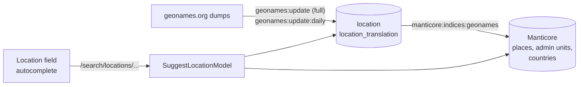
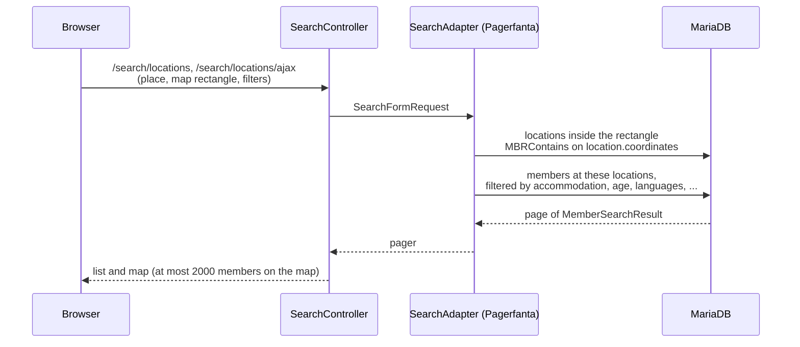

# Search and geography

Two search engines are used for different things:

| What | Where |
| --- | --- |
| Places (sign-up, profile location, search box, groups, trips) | Manticore indices built from geonames |
| Forum posts | Manticore real-time index `forum_rt` |
| Members on a map or in a list | MariaDB, spatial index on `location.coordinates` |

Manticore is reached with `manticoresoftware/manticoresearch-php` at `MANTICORE_HOST` /
`MANTICORE_PORT`.

## Places from geonames

- `location` holds places, administrative units and countries from geonames with their hierarchy
  (`country_id`, `admin_1_id` ... `admin_4_id`) and a `POINT` column with a spatial index.
- `SuggestLocationModel` asks Manticore for exact places, places, administrative units and countries
  in the member's language, and returns suggestions for the location pickers.

## Member search

Trips and activities use the same spatial queries to find legs and activities near a member or in the
visible map area.

## Forum search

`ForumSearchIndex` keeps the `forum_rt` document of a post up to date whenever a post is written,
edited or deleted. Failures are logged; the forum works without the search. `ForumSearch` queries the
index, filters by visibility, group membership and deletion state, and loads the posts from the
database for display. `manticore:indices:forum` rebuilds the index from scratch.
