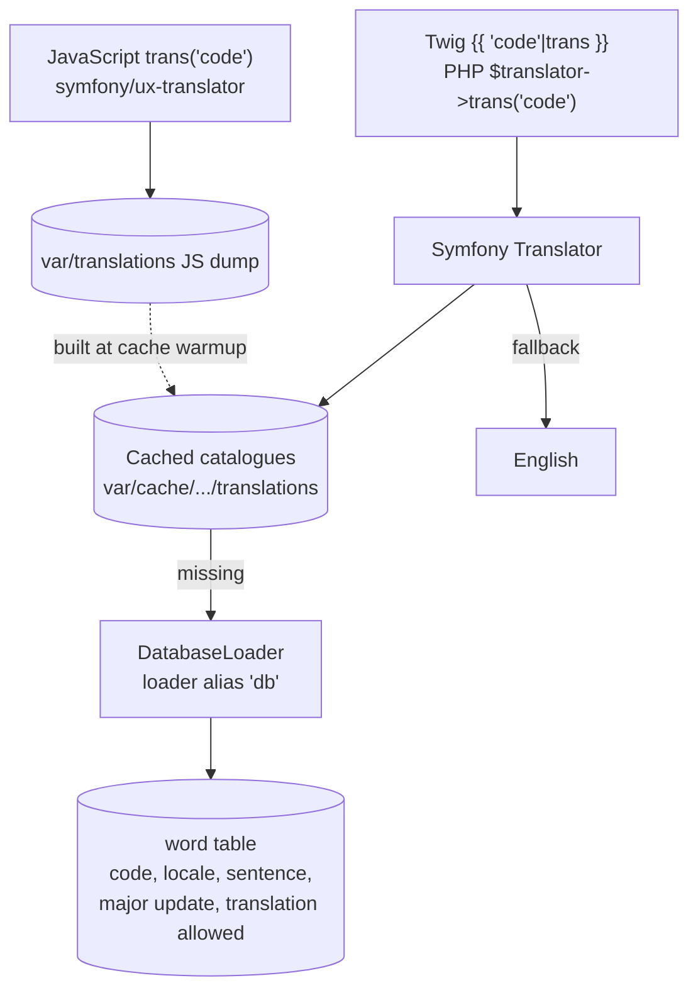
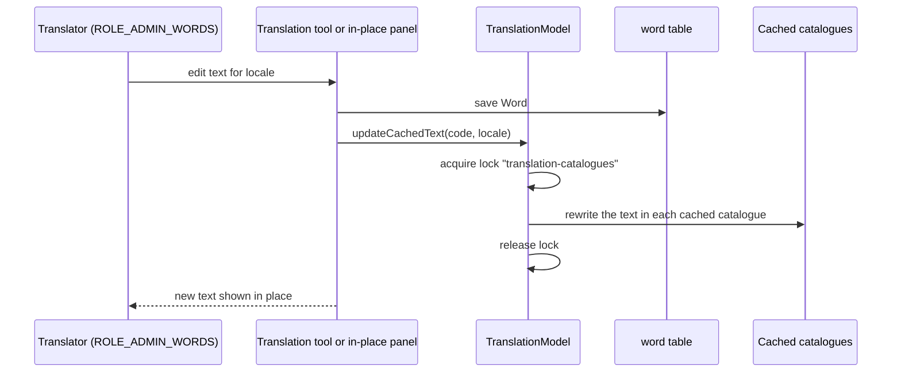

# Translations

BeWelcome is translated by volunteers into many languages on the site itself. The texts are stored in
the database, not in files.

## Where texts come from

- Each text is a `Word` row: a code, a locale, the sentence, and for English the date of the last
  major change and whether the text may be translated.
- `DatabaseLoader` builds a catalogue per locale. A translation older than the last major change of
  the English text is ignored and the English text is shown instead.
- Files in `translations/` are placeholders that tell the translator which locales and domains exist.
- `symfony/ux-translator` dumps the catalogues for JavaScript at cache warmup. `App\Kernel` removes
  Symfony's own translation warmer so the catalogues aren't built twice (memory limit).

## Changing a text

- **Translation tool** (`/admin/translations`): lists, searches and edits texts per language; shows
  missing and outdated translations; previews mail and page mockups in the chosen language.
- **In-place translation**: translators can switch on translation mode. `InPlaceTranslations` collects
  the texts a page used and lists them at the bottom; each opens in a side panel to edit, add or create
  the English original. The page shows the saved text without a reload.
- Only the changed text is rewritten in the cached catalogues, under a lock, so a save doesn't need a
  full `cache:clear`.

## Locales

`LOCALES` lists the languages the site offers. The locale of a request comes from the URL or session
(`LocaleListener`), and after login from the member's preference (`UserLocaleListener`). Mails are
rendered in the receiver's language. Policies (terms, privacy) are separate documents per locale
(`DOCUMENT_LOCALES`).
