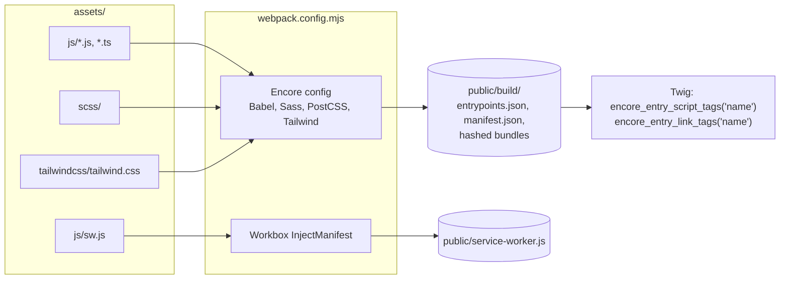

# Front end

Pages are rendered on the server with Twig. JavaScript adds behaviour per page; there is no
single-page application.

## Build

- Packages are installed with **bun** (`bun.lock`); `bun encore dev --watch` rebuilds while you work,
  `make build` builds for production.
- Every page loads the `bewelcome` and `tailwind` entries from the base layout and adds the entries it
  needs (`search/loadcontent`, `trips`, `profile/edit`, `conversations`, `admin/massmail`, ...). The full list
  of entries is in [`webpack.config.mjs`](../../webpack.config.mjs).
- Asset URLs in templates go through `asset()` with the Encore manifest.

## Styles

- The redesigned pages use **Tailwind CSS 4** (`assets/tailwindcss/`, `tailwind.config.js`).
- Older pages still use **Bootstrap 5** with the site's SCSS (`assets/scss/`). Both coexist while
  pages are moved to the new design.
- Mails use their own stylesheet (`email` entry, Foundation for Emails), inlined when sent.

## Libraries

| Purpose | Library |
| --- | --- |
| Maps | Leaflet with MapLibre GL tiles, marker clusters, fullscreen |
| Rich text | CKEditor 5 (`CkEditorType`: forum posts, group settings, activities, notes, mass mail, ...) |
| Location and member pickers | autocomplete widgets backed by `/search/locations/...` and `AutoCompleteController` |
| Dates | Litepicker (requests, profile), Day.js |
| Dialogs | Micromodal |
| Charts | Chart.js (statistics, treasurer) |
| Image cropping | Croppie (avatars) |
| Texts in JS | `@symfony/ux-translator` |

## Progressive web app and push

`public/manifest.webmanifest` and `public/service-worker.js` (built by Workbox from `assets/js/sw.js`)
make the site installable. The service worker receives browser push notifications and opens the page a
notification points to. Subscribing and unsubscribing is done by `assets/js/browserPushPreference.js`
against `BrowserPushSubscriptionController`. See [Background jobs](05-background-jobs.md#browser-push).

## Side panels

Some pages open a side panel with another page in an `iframe` (`?embed=1`): contacting a member,
editing a profile section, editing a translation. The panel page is a normal route; `base.html.twig`
leaves out the menu, side menu and footer when `embed` is set. See `EmbedFrameListener` in
[Request lifecycle](02-request-lifecycle.md).
