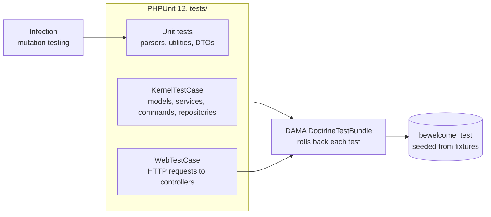
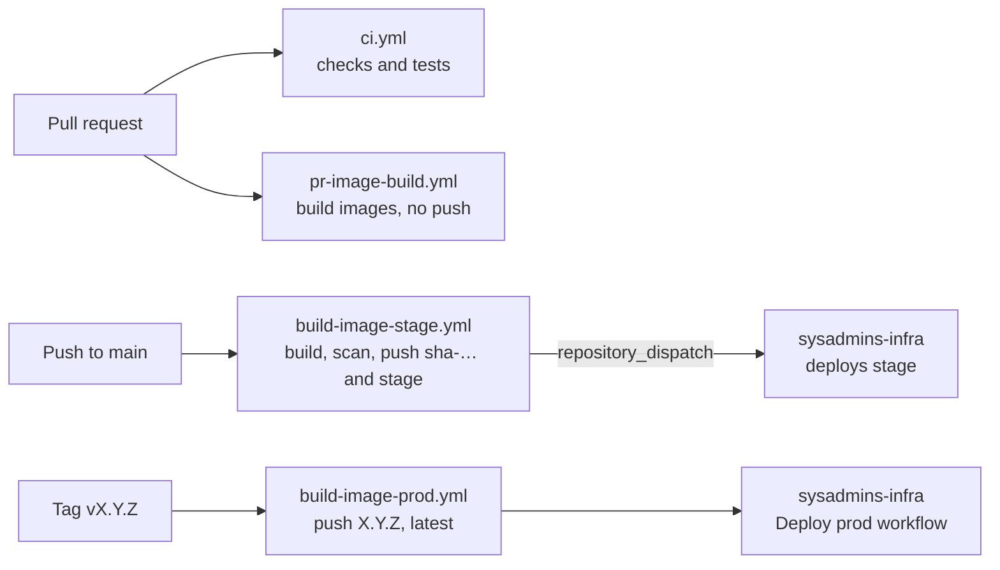

# Quality and delivery

## Tests

- `tests/` mirrors `src/` (`tests/Controller`, `tests/Model`, `tests/Service`, ...).
- Controller tests send HTTP requests through the kernel (`WebTestCase`), log in as fixture members
  and check the response and the database.
- The test database name gets the suffix `_test` (plus `TEST_TOKEN` when tests run in parallel).
  DAMA DoctrineTestBundle wraps each test in a transaction that is rolled back.
- In the test environment sessions use the mock file storage and the mailer the `null://` transport.

## Static checks

| Command | Runs |
| --- | --- |
| `make check` | php-cs-fixer, phpcs, PHPStan (with Doctrine, Symfony and Mockery extensions), phpcpd, YAML lint, Doctrine schema validation, `make security` |
| `make test` | PHPUnit with coverage, Infection, integration tests |
| `make security` | `composer audit`, `bun run audit` |
| `make phpci` | all of the above and phploc |

Git hooks (`make hooks`) fix and check staged PHP files on commit and run `make check` on push.
Rector ([`rector.php`](../../rector.php)) is used for upgrades.

## CI and images

- `ci.yml` runs on pull requests, on pushes to `develop` and `main`, and nightly.
- The images (PHP-FPM with `vendor/` and the built assets, and Nginx serving `public/`) are built in
  GitHub Actions and pushed to `ghcr.io/bewelcome/rox`. Servers only pull them; there is no build on a
  server.
- How the images run, the scheduler for the console commands, Manticore, the database and the mail
  server are described in `sysadmins-infra`.
