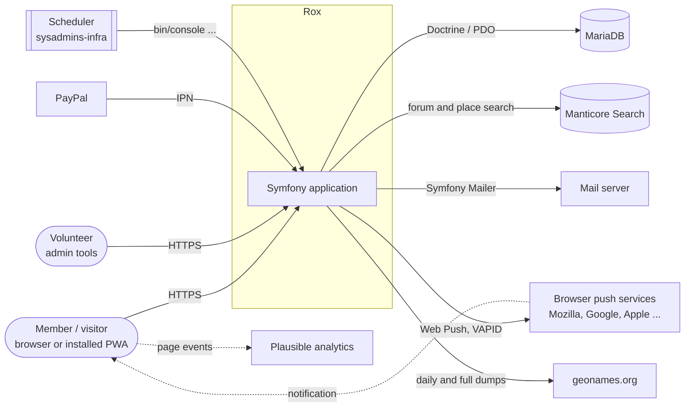
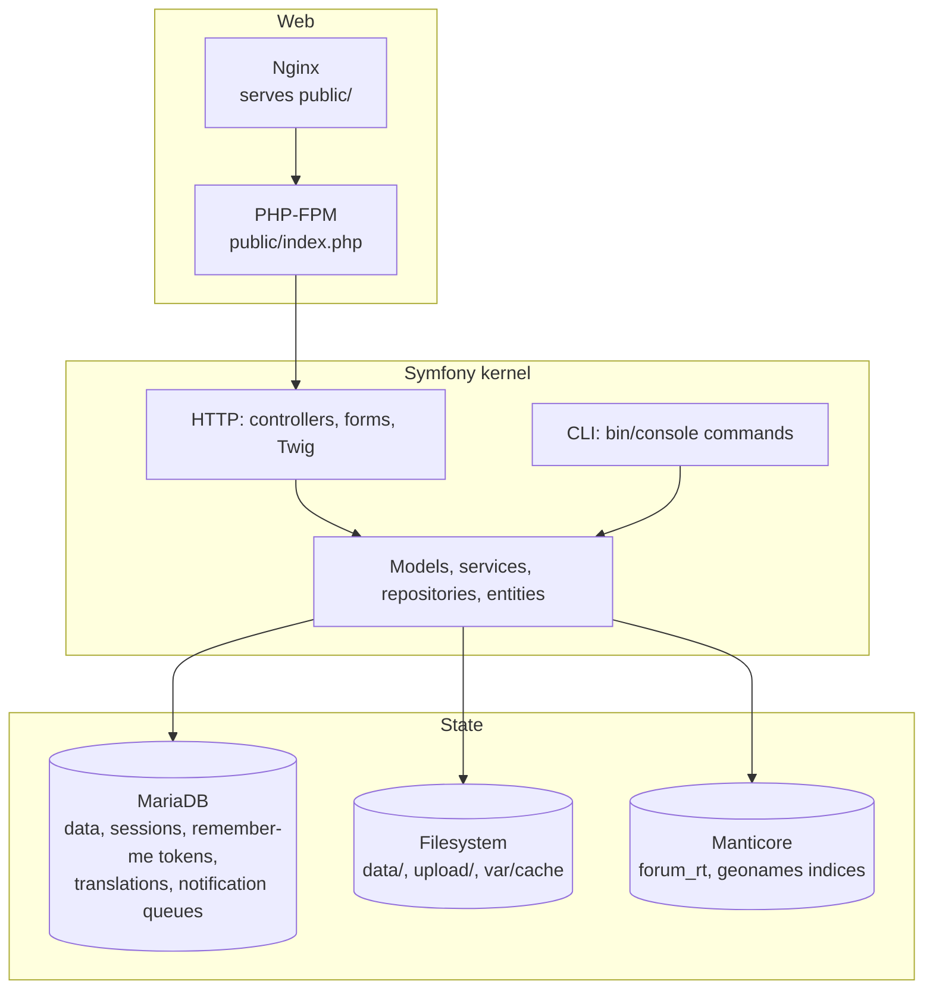

# Rox architecture

Rox is the software behind [BeWelcome](https://www.bewelcome.org), a hospitality exchange network run
by volunteers. It is one Symfony 8.2 application (PHP 8.5) that renders HTML pages on the server with
Twig, stores its data in MariaDB through Doctrine ORM, and uses a few small JavaScript bundles on top.

This folder describes how the application is built. How the containers, servers and cron jobs are set
up is covered in the `sysadmins-infra` repository, not here.

## Contents

| Document | What it covers |
| --- | --- |
| [Code structure](01-code-structure.md) | The layers in `src/` and how they depend on each other |
| [Request lifecycle](02-request-lifecycle.md) | What happens between an HTTP request and its response |
| [Data model](03-data-model.md) | Database, entities, legacy tables shared with `main`, migrations |
| [Security](04-security.md) | Login, members' rights as roles, voters, CSRF, signed mail links |
| [Background jobs](05-background-jobs.md) | Console commands, notification queues, mails and browser push |
| [Search and geography](06-search-and-geo.md) | Manticore indices, geonames, spatial member search |
| [Translations](07-translations.md) | Texts in the database, catalogue cache, in-place translation |
| [Front end](08-frontend.md) | Webpack Encore bundles, styles, maps, service worker |
| [Quality and delivery](09-quality-and-delivery.md) | Tests, static checks, CI and image builds |

## System context

## Runtime building blocks

Things to know before reading further:

- **One application, two entry points.** Web requests go through `public/index.php`; scheduled work
  runs as `bin/console` commands. Both use the same services and entities.
- **No message queue.** Asynchronous work is stored in database tables (notification queues, mass
  mail, trip notifications) and processed in batches by commands that the scheduler calls. Browser
  push for a single action is sent right after the response, on `kernel.terminate`.
- **The database is shared with `main` during the transition.** `main` is the code currently running
  in production; `develop` (this code base) adds its own tables next to `main`'s and copies the data
  in migrations. See [Data model](03-data-model.md#shared-with-main).
- **Translations live in the database**, not in files. See [Translations](07-translations.md).
